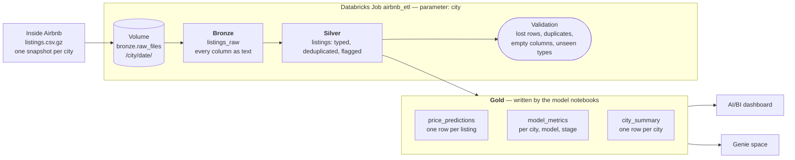

# Architecture

A medallion lakehouse on Databricks (Unity Catalog, Delta tables). One Databricks Job, `airbnb_etl`, runs the same code for every city; the city is its only parameter.

## Layers

| Layer | Tables | Purpose |
|---|---|---|
| Bronze | `airbnb.bronze.raw_files` (Volume), `airbnb.bronze.listings_raw` | The downloaded file as it is, every column as text, plus city and snapshot date. Nothing is lost if a later step is wrong. |
| Silver | `airbnb.silver.listings` | One row per listing per city: types fixed (`"$1,234.00"` → 1234.0, `"95%"` → 0.95, `"t"/"f"` → boolean), duplicates removed. Problems are flagged, not deleted: `is_valid_price`, `is_price_outlier` (3×IQR of log price per city and room type), `is_long_stay`, `has_reviews`. Missing values stay NULL; the model fills them from the training split only. |
| Gold | `airbnb.gold.price_predictions`, `model_metrics`, `city_summary` | Model predictions next to the baseline for every listing, errors per city and stage (`test` for Sydney and Melbourne, `first_run` for Brisbane), and a city summary. Every table and column has a Unity Catalog comment, which Genie reads. |

## Rules

- **Adding a city is one line** in `config.CITIES`; no code is copied.
- **Safe to re-run:** each run replaces only its own city's rows, so cities never overwrite each other.
- **Checks on every run:** `validation.py` reports lost rows, duplicates, entirely empty columns and unseen room types as warnings, so a new city does not fail silently.
- **No leakage:** `features.check_no_leakage` stops the model if a column computed from the price (`estimated_revenue_l365d`, `price_quote_*`) is used as a feature.